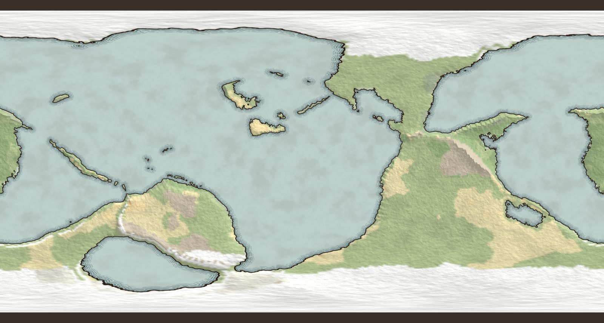
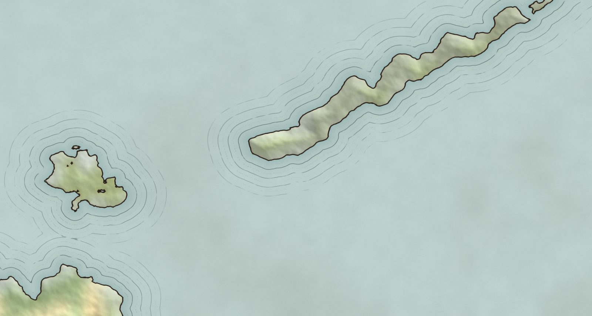
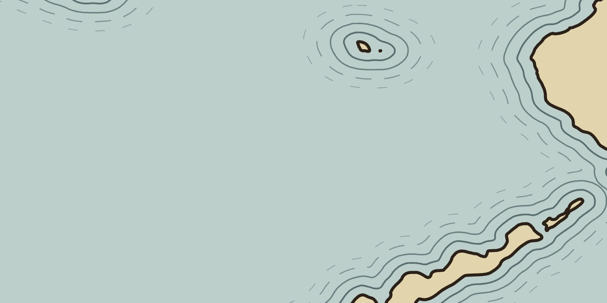

# WebMap spike

A throwaway spike for a browser map editor built on `RoguelikeToolkit.World.Core`. It tests two things:

1. **Can Core run in the browser as is?** It is compiled to `browser-wasm` and runs in a Web Worker.
2. **Does a distance-field coastline give a hand-drawn look, and can SVG export reproduce it?** The renderer uses a jump-flood signed distance field (SDF) on the GPU, and the SVG export contours the same field.

It is not part of the solution and CI does not build it.



| Screen (WebGL2), zoomed | SVG export, same area |
|---|---|
|  |  |

## Run

```bash
./build.sh                                # dotnet publish Engine -> web/_framework (no wasm workload needed)
python3 -m http.server -d web 8080        # any static server; open http://localhost:8080
```

Controls: drag to pan (wraps east-west), wheel to zoom, change the sliders, then **Export SVG**.

## Pipeline

```
Worker  Core (wasm): WorldBuilder.Build() -> tile vectors, icosphere faces, heights, biomes
        JS: forward-rasterize spherical triangles -> 2048x1024 equirect height + biome color
GPU     field   = height(domain-warped on the sphere) + fBm          <- the coastline is sign(field)
        seeds   = sub-pixel zero crossings (one Newton step along the gradient)
        JFA     = 12 passes, x wraps, x metric scaled by cos(lat)
        sdf     = signed distance in field pixels (+ land)
        display = coast ink, shallow halo, ripple rings, hill shade, paper grain
SVG     marching squares on the same sdf: iso 0 = coast, iso -k*ring = ripple rings
        -> Douglas-Peucker -> Chaikin -> Inkscape layers
```

Every visual decision downstream of the field is a function of one signed distance. The screen and the export do not each work out their own geometry: they read the same field.

## Measured

Headless Chromium on a CI box. The GPU numbers come from SwiftShader, a CPU rasterizer, so treat them as an upper bound. On a real GPU the field and JFA stage takes milliseconds.

| | size 5 (10,242 tiles) | size 6 (40,962 tiles) |
|---|---|---|
| .NET runtime boot in the worker | 140 ms | – |
| `Build()` in wasm (Mono interpreter) | 1.6 s | 3.0 s |
| `Build()` on desktop .NET 10 JIT | 0.24 s | 0.53 s |
| Rasterize 2048×1024 (JS) | 96 ms | 174 ms |
| Field + JFA + SDF at 4096×2048 (SwiftShader) | 7.9 s (incl. shader compile) | 5.9 s |
| SVG export (contour 5 iso levels, simplify, smooth) | 0.8 s | 1.2 s, 2.3 MB |

- **Download:** `_framework` is 6.6 MB raw and **1.5 MB with brotli**. That covers the trimmed BCL, Core and the runtime.
- **Determinism:** seed 42 at size 5 hashes to `F97DFDD5` under both desktop JIT and browser wasm. Height bits and biomes are identical, so a world seed means the same planet everywhere.

## Findings

- **Core needed one change: in-memory stores on browser/WASI use the heap.** `MemoryMappedFile.CreateNew` throws `PlatformNotSupportedException` in the browser. `WorldDataStore` now takes the same `AllocHGlobal` path that netstandard2.1 (Unity) already used. Plugin discovery (`AssemblyLoadContext`) is simply not called. Nothing else needed changing: no Reflection.Emit, no threads, and the YAML loader is AOT safe.
- **The interpreter is roughly 6× slower than JIT.** That is fine for one generation per user action. If it ever matters, the next steps are wasm AOT (the `wasm-tools` workload plus Emscripten), then splitting the pipeline so the sim can re-run from stage N.
- **Faces must reach the cartography layer.** Interpolating barycentrically over the icosphere faces gives smooth coasts and smooth biome transitions. Nearest-tile sampling gives hexagons, which the first build here had. The store throws the faces away; the engine regenerates them with `IcosphereGenerator.Generate`, which is deterministic and keeps the same vertex order.
- **Closing contours on a planet needs a topology rule, not just orientation.** If land joins across both poles, oceans are holes with no outer ring, and a lone hole fills under nonzero. The fix has three parts:
  - Rings keep the inside on their right.
  - Rings that circle the planet close through the south pole.
  - A frame rectangle is added when the north pole is inside.

  Winding is then exactly 1 or 0 for any topology. Each ring is emitted in the wrapped copies that reach the frame, all in one path, so lakes cut holes across the antimeridian.
- **Ripples come out of the distance field directly.** No Clipper offsetting is needed: offsets of the coast are just other iso-levels of the SDF, on screen and in the export alike.

## Not done (deliberately)

- **Projection:** equirectangular only, so the poles stretch. A real editor works in a map document with its own projection; a local azimuthal projection suits regional maps.
- **The screen breaks the outer ripple rings with noise; the SVG approximates that with dasharrays.** The rule should be: style randomness is a function of position, implemented the same way in both renderers.
- **Not yet drawn:** rivers (`RiverCatalog`), mountain symbols, forests, labels.
- **Editor features are out of scope:** mask painting, undo, document model, tiling beyond 4096×2048.
