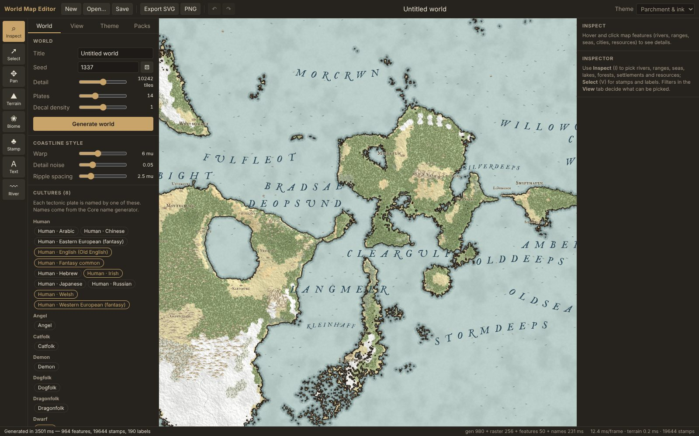
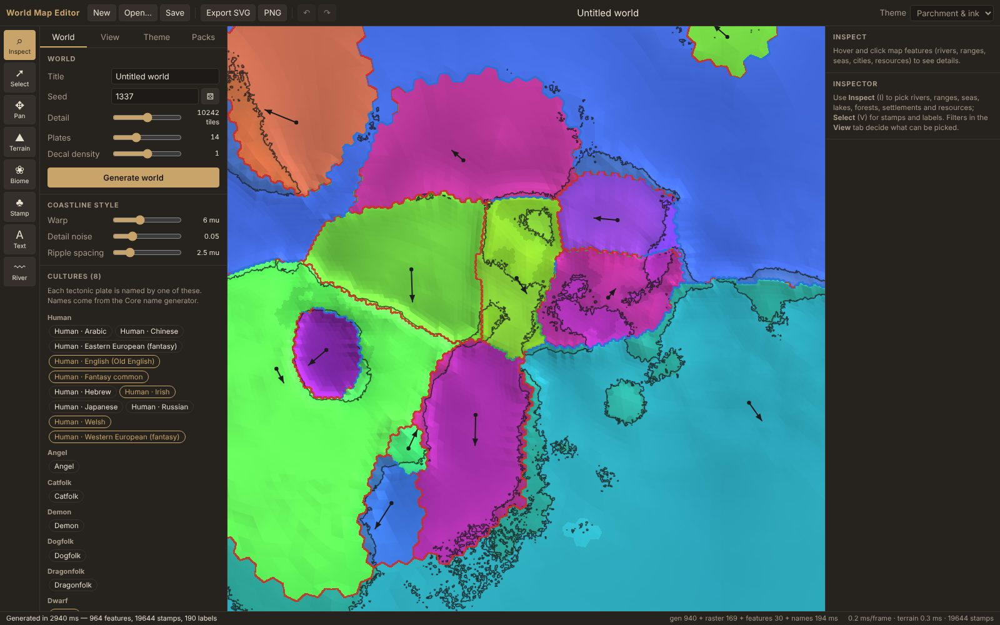
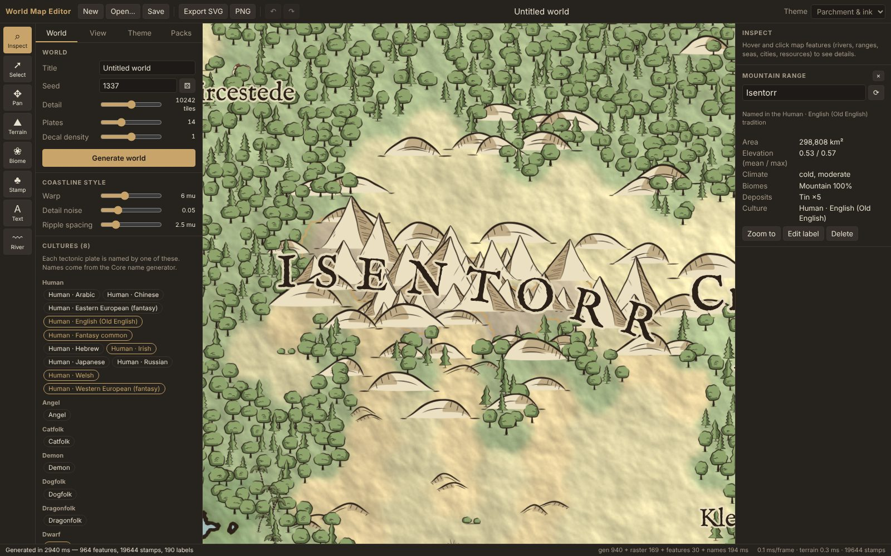
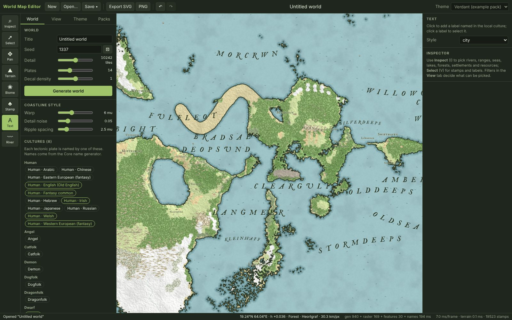
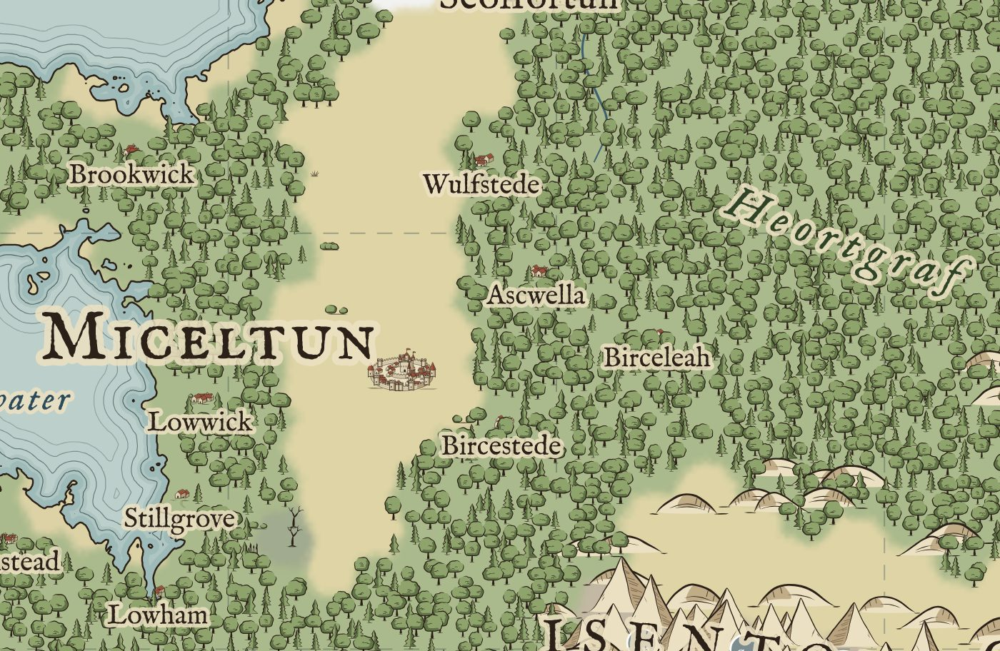

# World Map Editor

A browser map editor in the style of Inkarnate, built on `RoguelikeToolkit.World.Core`:

- **Generate:** Core generates the planet in the browser (.NET → WebAssembly, in a worker).
- **Draw:** the editor turns the planet into a hand-drawn map.
- **Edit:** you sculpt terrain, paint biomes, place stamps, write labels and draw rivers.
- **Export:** vector SVG, PNG, and WKT (a CSV of rivers, towns, deposits and area anchors in lon/lat, for GIS tools).



| Plates + topography view | Inspecting a mountain range |
|---|---|
|  |  |

| Theme from a content pack | SVG export (vector coast, rings, symbols, glyph-outline labels) |
|---|---|
|  |  |

## Run

```bash
./build.sh --engine      # publish the .NET engine into public/_framework (once, or after Core changes)
npm install
npm run dev              # http://localhost:5173

./build.sh               # full production build into dist/ (static files; any web server)
./build.sh --aot         # same, with the engine AOT-compiled (needs: dotnet workload install wasm-tools)
```

On Windows, use `build.ps1` with `-EngineOnly` / `-Aot`. Other scripts:

- `npm test`: vitest, engine logic, no browser.
- `npm run typecheck`

Requirements: a WebGL2 browser with `EXT_color_buffer_float`. That covers every current desktop browser.

## What it does

| Area | Features |
|---|---|
| World | Seed, detail (icosphere level), plate count, cultures. Each plate is named by one race × culture from Core's name generator. |
| Features | Rivers, lakes, seas and oceans, mountain ranges, valleys and canyons, forests, a settlement hierarchy (capital, city, town, village) and 13 resource-deposit types. Features are extracted from Core's catalogs and named by Core's `NameGenerator`. "Sea" is a new place kind. |
| Inspect | Hover and click any feature to see its facts: area, length, discharge, climate, biome mix, deposits, culture. Rename it, re-roll its name in its own culture, zoom to it, or delete it. Delete also removes its label, river and marker, as one undo step. |
| Filters | View presets: Map, Plates, Plates + topography, Topography, Biomes, Resources. There are also per-layer toggles and per-kind and per-deposit filters (coal, iron, gems…). Hidden features cannot be picked. |
| Edit | Terrain brush (raise, lower, smooth, flatten, roughen, paint land, paint sea). Biome brush. Land-use brush (farmland, ashlands, pasture, built-up: drawn over the biome, never changing it). Climate brush (temperature and rainfall offsets, tinted while active). Stamps: place, scatter or erase. Select, move, rotate, scale, flip and delete stamps and labels. Text tool: new labels are named in the local culture. River tool. Every edit is undoable. |
| Text | All labels are vector glyph outlines (opentype.js). Baselines can be straight, arched, or follow a river. The same path data is drawn on screen and written to SVG. |
| Content | Packs carry themes, biomes, assets (procedural generator presets or authored SVG with palette tokens), placement rules and fonts. Packs layer by id. Try **Packs → Example**: `public/packs/example-pack.json`. |
| Theming | The live theme editor covers map colors, line weights, biome colors, stamp inks, typography per label kind, and the editor chrome. Edits go to a "My edits" overlay pack: non-destructive, resettable, exportable as a pack. |
| Files | `.wmap` (gzip; JSON header + raw typed-array rasters); SVG with Inkscape layers; PNG of the current view; `.wkt.csv` (columns `wkt,layer,kind,name,id,attrs`, EPSG:4326, rivers cut at the antimeridian; areas are their label anchor because the document stores them as tiles, not outlines). |

Keys:

| Keys | Action |
|---|---|
| I / V / H / B / G / S / T / W | Tools |
| `[` `]` | Brush size |
| Wheel | Zoom |
| Middle/right drag, or Space + drag | Pan |
| Ctrl+Z / Ctrl+Shift+Z | Undo / redo |
| Ctrl+S / Ctrl+O | Save / open |
| In Select: R, `[` `]`, F, Del | Rotate, scale, flip, delete |

## Architecture

```
React views (src/ui)          dumb components: render state, call commands
   │ useSyncExternalStore
View models (src/viewmodels)  MVVM: one per panel; immutable state snapshots + commands; DOM-free
   │
Editor (src/engine/Editor.ts) Facade / composition root: owns every service, exposes use cases
   ├─ WorldService ──postMessage──► world.worker: Core (.NET wasm) → rasterize → features → names
   ├─ MapDocument                 aggregate root: rasters + entity stores + world reference data
   ├─ UndoStack + Commands        every mutation (raster CoW blocks, entity add/remove/update, composite)
   ├─ Tools (Strategy) + ToolController (DOM input → tool calls, universal pan/zoom)
   ├─ PackRegistry → AssetLibrary (atlas + SVG symbols), FontLibrary → LabelCache
   └─ MapRenderer (WebGL2) + Overlay (Canvas 2D) + SvgExporter (+ export.worker)
```

- **Patterns:**
  - Observer: a typed `Emitter` on documents, stores, selection, undo and packs.
  - Command, with coalescing (a slider drag is one undo step) and Composite.
  - Strategy (tools), Proxy (`WorldService`), Facade (`Editor`), MVVM.
- **Separation:** tools see the editor only through `ToolContext`. View models see only the `Editor`. Nothing under `src/engine` imports React.
- **Platform services:** file pick and save are injected into view models as a `FileService`.
- **Themes are data.** The renderer reads colors and widths from the theme every frame. Stamp inks are resolved when the atlas is built (palette tokens), so switching themes re-inks the map without touching the document.

### Projection and styling

The map is **Mercator, clipped at ±79.17°**, giving a 2048×1536 map-unit (mu) square-pixel document:

- Mercator is conformal, so shapes and wave rings keep their proportions. Equirectangular stretched the spike's north and south coasts.
- **Every stylization is computed in map space:** domain warp, detail noise, SDF distances, ripple spacing, stamp and label sizes. Ripples therefore have the same width and spacing at every latitude. Nothing is styled on the sphere and then projected.

### Rendering pipeline (incremental)

| Pass | Resolution | Notes |
|---|---|---|
| field | 2× (4096×3072) | elevation, domain-warped by cylinder noise (wraps in x) plus detail noise |
| seed | 2× | sub-texel zero crossings as **relative** offsets (RG16F, half the memory of absolute RG32F) |
| JFA | 2× | **bounded** jump flood, steps 64→1, reach 127 px |
| SDF | 2× | signed distance in mu (R16F): coast = 0, ripple ring k = −k·ring |
| colorize | 1× | biome ids → theme palette with an 8-tap blend |
| display | screen | per frame; mode (styled, biomes, elevation, plates) and layer flags in one shader |

- **Brush strokes become physics on demand.** A stroke only repaints pixels; **Apply physics** (terrain and biome panels) makes it count:
  - The pixel difference against what the engine last produced is averaged per icosphere tile into a sparse edit table. Sculpt edits are added to the tectonic relief *before* climate and erosion, so a drawn ridge casts a rain shadow, sheds talus and drains like any mountain. Fix edits pin the final height instead. A repainted biome (covering 40% of a tile) pins that tile's biome: hydrology classifies its cover from it and the biome stage keeps it.
  - **Climate paint** is a pair of signed-byte rasters (`warmth`, `wetness`, full scale ±0.4 temperature / precipitation units) kept in the document and saved in the `.wmap` (v3+; older files read as unpainted). Unlike height and biome strokes it is not diffed against a baseline: it is an input, re-read whole on every apply, and each tile takes the mean paint under it (below 0.01 it counts as a stray dab). The engine adds the offset last, so winds, rain shadows and ocean currents are untouched elsewhere. Revert clears it; undo restores it.
  - **Land use** (farmland, ashlands) is its own byte raster (`landuse`, `.wmap` v4), drawn over the biome by the renderer. A biome is what the climate grows; farmland is what people did to it, so it sits on Plains, Forest or Savanna without destroying them, and the physics neither reads nor rewrites it (Apply and Revert leave it alone; Clear removes it). Its ids 1-4 are Core's `LandUseId`, and on Apply each land tile that is at least 40% one painted use becomes a `PinLandUse` pin in the edit table (the raster stays the authority: erase the paint and the pin goes; water is never pinned). Core never reads a pin back into the physics, so this changes nothing visible by itself; it is what a host's allocation plugins see as "the author decided this" (`docs/API.md`, *Land use*). Plugin-allocated land use is deliberately **not** composited into this raster: it would then look like hand paint and be re-pinned on the next Apply.
  - **Climate** (View > Climate, with Temp / Rain / Currents / Seasons and a legend; presets *Climate* and *Winds & currents*) colours the whole map by what Core's climate stage produced, and **Wind arrows** / **Current arrows** draw the prevailing wind and the sea currents (red = warms the coast, blue = cools it; spacing follows the zoom). While any of them is on, the status bar reads out the tile under the cursor: temperature and rain index, wind and current direction and strength, the seasonal swing in K, and any painted offset from the Climate tool. Like capacity it is derived: Apply refreshes it, undo restores it, `.wmap` stores it as an optional `climate` blob (nine floats per tile; older files show nothing until the next Apply). Temperature is the engine's 0..1 index, not a thermometer: one unit is about 55 K, and the latitude profile is linear, so mid-latitudes read colder than Earth's.
  - **Land capacity** (View > Land capacity, with a Farming/Grazing/Game/Timber/Fish selector and a hover readout in the status bar) tints each tile by what it could carry, from Core's `LandCapacityStage`. It is derived, so it lives with the physics state: Apply refreshes it, undo restores it, and `.wmap` stores it as an optional `capacity` blob (older files simply show nothing until the next Apply). Coarse worlds over-credit farmland (see `docs/API.md`). Files saved before v4 painted these as biome ids 11 and 13: on load those pixels move into the land-use layer and the biome takes the nearest ordinary biome, so old maps open looking the same.
  - The planet (axial tilt, stellar flux, spin) is set in the Generate panel, stored in the `.wmap` settings (an older file reads as Earth) and handed to the engine on every apply, so re-deriving a tilted world keeps it tilted.
  - `WorldExports.ApplyEdits` (tiles, sculpt deltas, pinned heights, flag/biome words, temperature and precipitation offsets) replaces the engine's edit table and runs `World.Recompute()`: elevation, climate, erosion, hydrology, biomes and the river, lake, range and deposit catalogs, never the plate simulation. The call is pure in (seed, edits), so it is idempotent and never double-erodes. It is global (a ridge can send a river basin elsewhere), which is why it is a button and not part of the dab.
  - Identity survives. New features are matched to old ones by shared tiles or shared riverbed (`world/reconcile.ts`), not by ordinal id, so names carry over; deleted engine features are tombstoned and stay deleted; hand-made rivers, stamps and labels are untouched; savanna paint (no Core biome) is kept where it was drawn, and land use (below) is never touched.
  - One undo step swaps terrain, biomes, features, rivers, labels, stamps and the edit table together. **Revert** drops the table and reproduces the generated world exactly. A `.wmap` stores the sparse table (never the derived rasters); on opening, the baseline is rebuilt from it deterministically.
  - Sub-tile detail is the price: the table is per tile, so the applied raster is the engine's, not your pixels.
- **Edits are incremental.** A brush dab dirties a rect D:
  - The flood runs on D ⊕ 2·reach.
  - Only D ⊕ reach is committed.
  - A region that crosses the antimeridian becomes a wrapped full-width strip.
- **Edits within a frame are coalesced**, so N dabs cost one upload and one rebuild.
- **Undo is copy-on-write in 64×64 blocks.** Its cost scales with what a stroke touched, not with the map size.
- **Stamps** are drawn in one instanced draw call (sorted by y), from a mipmapped, premultiplied atlas.
- **Rivers** are ribbons with a minimum on-screen width.
- **Labels** are cached Path2D objects; each label's layout is cached by a signature.
- **SVG export:**
  - Reads back the SDF, contours it in a worker (marching squares, wraps in x, Douglas-Peucker, then Chaikin), and writes Inkscape layers.
  - Shared geometry (the coast, each label's outline) is defined once and referenced with `<use>`.
  - Stamps are `<symbol>`s.

## Measured

Headless Chromium in a CI container:

- **CPU timings** (Core, worker JS, main-thread JS) are representative.
- **GPU work runs on SwiftShader**, a CPU rasterizer. One idle frame takes about 0.4 s there, and a full-field JFA rebuild takes seconds. On any real GPU these passes take milliseconds. GPU numbers below are therefore marked as SwiftShader numbers, not editor costs.

| World generation, seed 7 | size 5 (10,242 tiles) interpreted | size 5 AOT | size 6 (40,962 tiles) interpreted | size 6 AOT |
|---|---|---|---|---|
| .NET runtime boot (worker) | 193 ms | 212 ms | | |
| Core `Build()` | 690 ms | **205 ms** | 3,555 ms | **1,034 ms** |
| Pull arrays across interop | 94 ms | 13 ms | 558 ms | 82 ms |
| Rasterize to 2048×1536 (JS, worker) | 148 ms | 143 ms | 260 ms | 209 ms |
| Feature extraction (JS, worker) | 27 ms | 27 ms | 102 ms | 90 ms |
| Name all named features (one batched Core call) | 112 ms | 23 ms | 91 ms | 34 ms |
| Populate stamps (main) | 102 ms (22,943 stamps) | 106 ms | 161 ms | 136 ms |
| Label placement (main) | 182 ms | 179 ms | 154 ms | 153 ms |

The rest is SwiftShader GPU work, not editor cost:

| Operation | Time |
|---|---|
| 40-dab terrain stroke, JS side (dabs + copy-on-write) | 9 ms |
| `.wmap` save | 0.67 s, 12.5 MB |
| `.wmap` load | 0.58 s; rasters and entities are byte-identical after the roundtrip |
| SVG export, full map | ~2.5 s, 17.5 MB (≈9 MB of it is IM Fell's rough glyph outlines) |

- **Download:** `_framework` is ~1.5 MB brotli interpreted, ~2.9 MB with AOT.
- **AOT:** about 3.4× faster `Build()`, for about 1 minute of extra build time.
- **App JS:** 200 kB, plus React 141 kB and opentype.js 172 kB (69 + 45 + 50 kB gzip).

## Findings

- **`self.onmessage = …` deadlocks the .NET runtime in a worker.**
  - `dotnet.create()` never resolves when the worker assigned `onmessage` before booting. The runtime uses the worker's message channel itself.
  - The fix is `self.addEventListener('message', …)`.
  - This costs nothing to avoid, but it is silent: no error, no rejection.
- **Projection, not shader tuning, fixed the polar distortion.** Once styling is computed in map space on a conformal projection, coastal waves look the same at 70° as at the equator.
- **Feature extraction belongs in JS, not Core.**
  - Core already exposes rivers, water bodies, ranges, deposits and city sites as catalogs.
  - The cartographic layer (ocean divided into basins at its straits, settlement hierarchy, label anchors, details text) is presentation. It runs in about 30 ms in V8.
  - Naming stays in Core, batched into one interop call.
- **Labels as outlines, not text:**
  - The SVG looks the same everywhere, with no font installation.
  - Hit-testing and collision use the exact geometry.
  - The cost is file size. Outline precision is 0.01 mu.

## Not done

- **Mobile:** there is no layout for small screens beyond a collapsed sidebar.
- **Regional maps:** there is no local azimuthal projection for detailed regional sheets. The document format leaves room for one.
- **Hand-drawn assets:** the core pack is procedural. Authored SVG assets are supported but not shipped.
